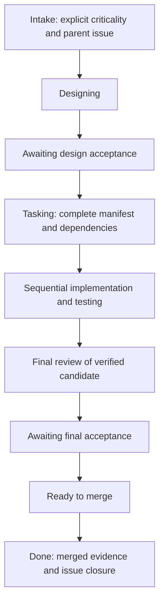

# Codex CLI multi-agent development setup

Reusable native Codex CLI configuration, role prompts, procedural skills, and templates. Copy the baseline into a new project, customize its GitHub repository and integration settings, then keep project-specific conventions in project/folder instructions.

The primary session is CTO. Architect, Task Manager, Developer, Tester, and Reviewer have separate responsibilities. Detailed procedures load through skills rather than filling the CTO context. The project's tracker is the persistent record; Git contains source code and tests.

## Persistent result ownership

| Record | Location | Author |
|---|---|---|
| Request, criticality, current stage | Parent feature issue | CTO |
| Clarification questions and answers | Parent issue comments | Architect / human, coordinated by CTO |
| Design and subsequent revisions | Versioned parent issue comments | Architect |
| Design acceptance or rejection | Parent issue comment referencing design comment/revision | CTO for Low/Medium; human for High |
| Atomic tasks, dependencies, acceptance criteria | Linked child issues | Task Manager |
| Implementation notes and deviation requests | Corresponding child issue | Developer |
| Test evidence | Child issue; consolidated feature evidence on parent | Tester |
| Final review | Parent issue linking child results | Reviewer |
| Final approval and completion | Parent issue | Human for Medium/High approval; CTO for Low approval and completion |

Create the parent before Architect starts. Keep its body a concise index; publish detailed results in versioned comments with stable references, applicable design revisions, and code commits. Each role publishes its own results. Handoffs carry status and links rather than full plans or logs. Temporary CLI body files are transport, not workflow state.

## Agent boundaries

| Agent | Required input | Owns | Completion output | Boundary |
|---|---|---|---|---|
| CTO | Request, explicit criticality, tracker context | Parent issue, stages, dispatch, approval coordination, delivery | Stage/status and result references | Does not implement product code |
| Architect | Parent issue, requirements, answers, repository context | Design revisions and design questions | Design result link, revision, status | Does not create implementation tasks or change product code |
| Task Manager | Accepted design reference | Child tasks, dependencies, acceptance mapping | Manifest/task links grouped by area and blockers | Does not change accepted design |
| Developer | Ready task, accepted design, branch/base, dependencies | Implementation, implementation notes, deviation requests | Candidate code and implementation/verification links | Does not weaken criteria, self-certify testing/review, close issues, or merge |
| Tester | Task criteria and exact candidate | Test code and verification evidence | PASS/FAIL/BLOCKED, tested SHA, evidence link | Does not fix production implementation |
| Reviewer | Accepted design, task results, exact base/head, verification | Independent technical review | PASS/FAIL/BLOCKED and review link | Does not edit implementation, grant human acceptance, or merge |

Only Developer delegates to Tester. CTO does not start duplicate testing. Role restrictions are behavioral; subagents inherit parent execution permissions. Agent posts use plain-text role signatures; logical assignment remains an open design decision.

## Criticality and shipment

| Gate | Low | Medium | High |
|---|---|---|---|
| Request intake | Explicit criticality required | Explicit criticality required | Explicit criticality required |
| Completed design acceptance | CTO | CTO | Human |
| Final technical review | Reviewer PASS | Reviewer PASS | Reviewer PASS |
| Final acceptance before merge | CTO | Human | Human |



Failed tests/reviews return to implementation through recorded correction decisions. Low has a shared budget of three automatic correction cycles per run; Medium/High await human direction. Material deviations return to design and renewed acceptance. Any active stage can become BLOCKED/CANCELLED with a reason. Recovery reconstructs state from tracker records and rechecks prerequisites.

Acceptance binds to an exact design comment and revision; final acceptance additionally binds to review and candidate head. A changed revision invalidates old evidence. PASS is technical evidence; acknowledgement of FAIL never changes it into PASS. CTO closes issues after the accepted head is actually merged into the configured integration branch.

## GitHub documentation and project setup

Use `$manage-github-issues` directly for all issue reads, design/result comments, approval records, task creation, status updates, recovery, and completion. Use ordinary Markdown with issue/design links and relevant commit references. `$ship-feature` owns the shipment order and approval gates; each specialist's skill defines its deliverable. There is no extra provider abstraction or workflow state file.

Set the GitHub repository, integration branch, and test/build guidance in the target project's `AGENTS.md`. Use one feature branch/PR and sequential writers, with a cap of three spawned threads. Release completed agent threads and verify Developer-to-Tester nesting before live use.

See [the project README](project-root/README.md) for installation, project customization, and illustrated Low/Medium/High paths. The examples are written walkthroughs of the issue comments and decisions agents should produce.

## Repository layout and instruction layers

```text
codex-global/AGENTS.md                  Global defaults example
project-root/README.md                  Project setup and demonstrations
project-root/codex-project/AGENTS.md    Project-root instruction template
project-root/codex-project/config.toml  Native Codex settings template
project-root/codex-project/agents/      Specialist roles
project-root/agents/skills/             Discoverable skills after installation
project-root/hooks/                     Legacy hook samples, deferred
AGENTS.md                              Repository contributor guidance
```

Global instructions model `~/.codex/AGENTS.md`; project instructions install at `<project>/AGENTS.md`; folder instructions install at paths such as `<project>/backend/AGENTS.md`. More specific applicable guidance specializes broader guidance. Source directory names are packaging placeholders; use the copy map, not a blind copy of `project-root/`.

## Runtime baseline and pending decisions

Observed local CLI: **0.162.1**. Configuration follows the current official [subagent documentation](https://learn.chatgpt.com/docs/agent-configuration/subagents) and [configuration reference](https://learn.chatgpt.com/docs/config-file/config-reference): standalone roles have names/descriptions/instructions, models and permissions inherit from the parent, and the current concurrency key is used. No per-role sandbox override or undocumented top-level `disabled_tools` claim remains. A live model/nesting/provider smoke test is still required; version observation and offline checks do not prove account access or end-to-end compatibility.

Models deliberately inherit the parent model until a project pins available models and supported effort values. This resolves conflicting model identifiers without assuming access to a particular model.

Legacy hook files are retained unchanged, with hooks disabled in the baseline config. Their event parsing, terminal input, approval timing, and enforcement need a separate decision. CTO checks approvals and prerequisites directly from GitHub issue comments. Automated enforcement remains deferred.

## Plain-text agent signatures

Every agent-authored GitHub issue/PR body, comment, or review ends with a blank line and its signature as the final line of normal text:

| Role | Signature |
|---|---|
| CTO | agent@cto |
| Architect | agent@architect |
| Task Manager | agent@task-manager |
| Developer | agent@developer |
| Tester | agent@tester |
| Reviewer | agent@reviewer |

Agents use only their own signatures and keep a single footer when editing their own posts. CTO-relayed human decisions are attributed honestly in the comment body and signed `agent@cto`. No new human signature is required. These labels are applied through instructions; no hook or posting helper is introduced.

Signatures identify agent roles; they do not change the GitHub account used to post or prove human approval. They are not added to source files, commit messages, or ordinary chat replies.
